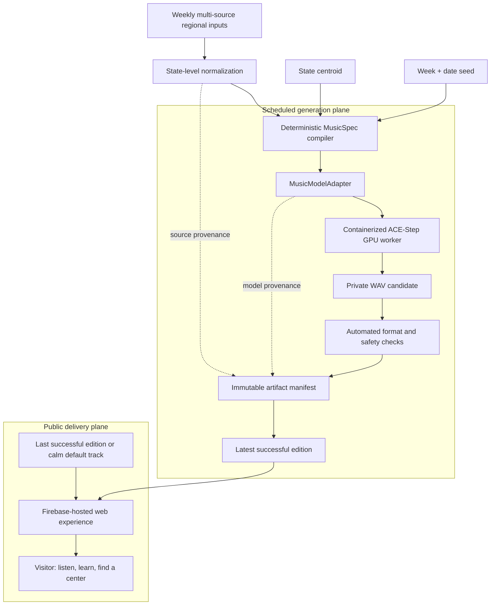

# Building Pulse of Giving: A Calmer Path from Data to Donation

Blood donation can feel bigger and more frightening than it is. The equipment is unfamiliar, eligibility rules can feel opaque, and the need itself is often presented as an alarming statistic. I wanted to build something that moves in the other direction: a small, calming experience that helps someone understand the need in their community, see that donation is manageable, and take a trusted next step.

This is personal for me. My wife went through plasmapheresis, and another person's blood donation quite literally helped save her life. That experience made the generosity behind donated blood impossible to treat as an abstraction. It also made me think about the gap between the quiet, ordinary act of donating and the extraordinary consequence it can have for a family.

That is the reason for **Pulse of Giving**: an experience that turns a community-shaped weekly signal into a short, calm instrumental piece, then hands the visitor to established blood organizations to learn more or find a donation center.

The product is not trying to become a blood bank, a scheduling platform, or a dashboard that turns scarcity into spectacle. Its job is narrower: make the first step feel human and doable.

## The product idea: your donation stays close to home

The emotional center is local generosity. Donated blood often serves people in the same broader community: someone who may live nearby, commute the same roads, or send their kids to the same schools. A person may never meet the recipient, but the consequence can be immediate and life-changing.

That is what the “community pulse” is meant to express. The music is not a medical alert and it is not a dashboard rendered as sound. It is a quiet reminder that an ordinary hour of donation can matter to people around us.

## Make the signal felt, without manufacturing urgency

The central idea is not “music about blood donation.” The data itself should influence the music.

Each weekly generation begins with an aggregated regional signal. The initial national rollout will explore state-level aggregation from multiple donation and blood-supply sources. The exact source mix is an input to the composition, not a public claim about inventory, eligibility, or immediate availability. State geography, the weekly date, and a normalized donation/supply signal become deterministic inputs to the music specification.

The state centroid gives each place a stable musical fingerprint; the date creates weekly variation; and the aggregated signal nudges harmonic color, density, and texture. The composition remains warm and instrumental in every state. It should never become anxious, dramatic, or manipulative.

That constraint matters. A public-interest product should not make people feel guilty or frightened in order to earn a click. The music is there to create a moment of reflection and calm, not to simulate an emergency.

The site then pairs the listening experience with the practical questions a prospective donor may actually have:

- What happens at an appointment?
- How much time should I plan for?
- What should I do before I donate?
- Where can I get authoritative eligibility guidance?
- Where can I find a legitimate local donation organization?

The call to action is intentionally outbound. Pulse of Giving should point people toward organizations that already operate collection, screening, scheduling, and clinical care. Building a second scheduling layer would add risk without adding much value.

## The system design: a weekly generation plane and a resilient public delivery plane

The product has two planes: a scheduled system that produces a new regional edition, and a simple public experience that plays the most recent successful edition. The public site does not expose source numbers or call the model on demand.

The model worker is not an internet-facing feature. It is a private, one-shot job that renders an edition, writes an immutable artifact, and exits. The public site has no route to the model API and no ability to request a generation.

That separation is what lets the user experience remain quiet and simple while the AI system behind it remains inspectable.

## A typed specification is the AI control plane

The generator is a typed Python service. A `CommunityPulseSnapshot` carries the source identity and URL, coverage area, publication and validity times, supply state, and verification status. The compiler turns it into a `MusicSpec`: the complete, versioned request for a composition.

The `MusicSpec` fixes the attributes the product needs to control:

- a week/date-derived seed for repeatability;
- a coarse state centroid for a stable regional signature;
- a 35-second duration and a tempo constrained to 64–80 BPM;
- a supply-state-aware musical direction that remains warm and unhurried;
- an instrumental prompt; and
- a negative prompt excluding vocals, lyrics, sirens, aggressive drums, harsh percussion, abrupt endings, and anxious or frightening moods.

The date belongs in the seed, not in a data claim. It gives the system a fresh weekly composition cadence even when one source has not published a new update. The interface will describe the result as music shaped by community inputs—not as a live or quantitative representation of blood supply.

This is a useful distinction in applied AI work: prompt text alone is not a control plane. A typed, validated specification makes the constraints observable, testable, and durable across model changes.

## The model adapter is the architectural center

The rest of the pipeline does not know how a particular music model queues work, names fields, or returns files. It depends on a small `MusicModelAdapter` contract: accept a `MusicSpec`, generate a requested number of candidates inside a supplied artifact directory, and return a `GeneratedCandidate` for each result.

Each candidate includes its local audio path and the *effective parameters* used to make it—prompt, seed, BPM, duration, adapter identity, model ID, upstream revision, task ID, and generation settings. The adapter also exposes `ModelProvenance`: model identity, pinned revision, upstream license, and model-admission metadata.

That boundary does several important things without becoming an abstraction for its own sake:

- It keeps artifact semantics stable if the underlying model or serving API changes.
- It makes a local fixture adapter useful for testing the entire artifact lifecycle without model weights or GPU time.
- It makes a production adapter portable between a laptop, an ephemeral cloud job, and a future managed worker.
- It treats inference parameters and model release status as artifact data, not deployment trivia.

The first real adapter targets ACE-Step’s Turbo profile. It submits a constrained request to the self-hosted `/release_task` endpoint, polls `/query_result`, then retrieves the generated WAV through the local service. The model-specific protocol ends there. Everything after that—analysis, manifest creation, fallback selection, and website delivery—uses the same domain objects regardless of which model rendered the audio.

## Containerizing the model, rather than outsourcing it

The inference worker is a dedicated GPU image, separate from the lightweight local compiler image. It starts from NVIDIA CUDA 12.8.1 on Ubuntu 22.04, installs Python 3.11 and the audio runtime dependencies, and builds ACE-Step from a pinned upstream commit with its frozen dependency lockfile. The Pulse generator is then installed into that same virtual environment.

At runtime, the container starts the ACE-Step API bound to `127.0.0.1:8001`. The render entry point waits for its health check, calls the adapter, writes a dated immutable artifact directory, uploads the result to private storage, and terminates the model process before the job exits. The HTTP interface exists only inside the container: there is no public inference URL and no prompt or audio request sent to a third-party generation API.

The cloud deployment shape follows the workload. A GPU job pulls the private image, uses a narrowly scoped service identity to upload an immutable artifact, and shuts down after the render. A persistent GPU service would add idle cost and attack surface for a product that needs periodic batch generation, not on-demand inference.

Containerizing this path is more than packaging. The image, the model revision, the Python dependency graph, and the invocation contract are all concrete, reviewable parts of the system. That is the level at which a self-hosted model becomes an engineering system rather than a notebook demo.

## Guardrails: a generation must stay calm, and the experience must stay available

Each generation becomes an immutable artifact containing its regional inputs, full `MusicSpec`, model provenance, candidate hash, and effective parameters. The public product is deliberately modest about what that artifact means: it is a community-shaped music edition, not a clinical or operational statement.

There is no manual approval step in the intended weekly experience. Instead, automated checks enforce the non-negotiables: a valid playable file, expected duration and format, safe loudness/peak bounds, instrumental-only intent, and the model/prompt configuration allowed by the product. If a new generation fails or the upstream inputs are unavailable, the site serves the previous successful edition. If none exists, it plays a calm default track. Visitors should never receive silence, a broken player, or a fabricated “live” alert.

Once an artifact passes automated checks, the public site resolves only the small `current.json` pointer to an immutable manifest. Audio downloads only after the visitor presses play, and the browser verifies the WAV’s SHA-256 against the manifest before playback. Hash verification is not a substitute for storage access controls; it is a final integrity check that makes an accidental replacement visible rather than silent.

## Current status and what comes next

The first self-hosted ACE-Step render has been generated on a containerized NVIDIA L4 GPU worker and deployed as a clearly labelled illustrative demo. The site is live on Firebase Hosting, and the model API remains private inside the worker. That is a meaningful milestone: the experience is now playing real model-generated audio, not browser synthesis.

Next is a weekly regional-input pipeline: identify appropriate national and state-level sources, normalize them into a deliberately coarse signal, pair them with state coordinates and the weekly date, and generate one calm edition per region. The fallback policy will make the public experience reliable even when a source or render misses a week.

Similarly, self-hosting a model does not make it automatically appropriate for public use. The model’s exact revision, license, output behavior, and automated output checks need an explicit, versioned admission policy.

## The engineering standard I want this project to represent

Pulse of Giving is a public-interest project, but it is also a systems project. I want it to demonstrate a version of AI engineering that is less interested in a flashy one-off demo and more interested in the details that let a system earn trust:

- model outputs that are reproducible and inspectable;
- data claims that match what the source actually says;
- immutable artifacts instead of mutable “latest” files;
- graceful degradation instead of fabricated fallbacks;
- automated constraints and graceful fallback where a visitor needs a reliable experience; and
- cloud infrastructure that runs only when it has work to do.

The music is the invitation. The reliable pipeline behind it is the promise.

If this project helps one hesitant person feel more at ease about donating, it will have done something worthwhile. And if it can show that AI systems can be built with warmth, restraint, and operational rigor at the same time, that is a standard worth carrying into other work too.
