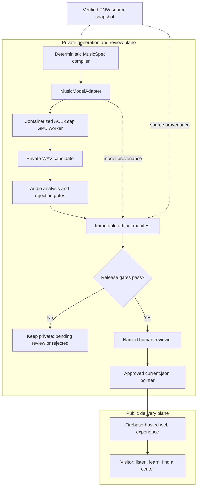

# Building Pulse of Giving: A Calmer Path from Data to Donation

Blood donation can feel bigger and more frightening than it is. The equipment is unfamiliar, eligibility rules can feel opaque, and the need itself is often presented as an alarming statistic. I wanted to build something that moves in the other direction: a small, calming experience that helps someone understand the need in their community, see that donation is manageable, and take a trusted next step.

This is personal for me. My wife went through plasmapheresis, and another person's blood donation quite literally helped save her life. That experience made the generosity behind donated blood impossible to treat as an abstraction. It also made me think about the gap between the quiet, ordinary act of donating and the extraordinary consequence it can have for a family.

That is the reason for **Pulse of Giving**: an experience that turns a verified regional blood-supply update into a short, calm instrumental piece, then hands the visitor to established blood organizations to learn more or find a donation center.

The product is not trying to become a blood bank, a scheduling platform, or a dashboard that turns scarcity into spectacle. Its job is narrower: make the first step feel human and doable.

## The product idea: make the signal felt, without manufacturing urgency

The central idea is not “music about blood donation.” The data itself should influence the music.

Each generation begins with a regional supply snapshot. The snapshot is classified into a deliberately small set of states—steady, needs support, or high need. That state adjusts a constrained music specification: for example, tempo, harmonic color, and texture. The composition remains warm and instrumental in every state. A higher-need state can be a little more spacious or unresolved, but it should never become anxious, dramatic, or manipulative.

That constraint matters. A public-interest product should not make people feel guilty or frightened in order to earn a click. The music is there to create a moment of reflection and calm, not to simulate an emergency.

The site then pairs the listening experience with the practical questions a prospective donor may actually have:

- What happens at an appointment?
- How much time should I plan for?
- What should I do before I donate?
- Where can I get authoritative eligibility guidance?
- Where can I find a legitimate local donation organization?

The call to action is intentionally outbound. Pulse of Giving should point people toward organizations that already operate collection, screening, scheduling, and clinical care. Building a second scheduling layer would add risk without adding much value.

## The system design: a private generation plane and a public delivery plane

Generating audio is not the product boundary. The important boundary is between a private, reviewable model run and a public experience that can make claims about a community. I designed the system as two separate planes, joined by an explicit promotion step.

The model worker is not an internet-facing feature. It is a private, one-shot job that renders a candidate, writes a review artifact, and exits. The public site has no route to the model API, no ability to request a generation, and no permission to make an unpublished file audible.

That separation is what lets the user experience remain quiet and simple while the AI system behind it remains inspectable.

## A typed specification is the AI control plane

The generator is a typed Python service. A `CommunityPulseSnapshot` carries the source identity and URL, coverage area, publication and validity times, supply state, and verification status. The compiler turns it into a `MusicSpec`: the complete, versioned request for a composition.

The `MusicSpec` fixes the attributes the product needs to control:

- a Pacific-date-derived seed for repeatability;
- a 35-second duration and a tempo constrained to 64–80 BPM;
- a supply-state-aware musical direction that remains warm and unhurried;
- an instrumental prompt; and
- a negative prompt excluding vocals, lyrics, sirens, aggressive drums, harsh percussion, abrupt endings, and anxious or frightening moods.

The date belongs in the seed, not in the data claim. It gives the system a fresh composition cadence even when a source has not published a new update. The resulting artifact carries both timestamps, so the interface never has a reason to call a daily track “live” merely because it was generated today.

This is a useful distinction in applied AI work: prompt text alone is not a control plane. A typed, validated specification makes the constraints observable, testable, and durable across model changes.

## The model adapter is the architectural center

The rest of the pipeline does not know how a particular music model queues work, names fields, or returns files. It depends on a small `MusicModelAdapter` contract: accept a `MusicSpec`, generate a requested number of candidates inside a supplied artifact directory, and return a `GeneratedCandidate` for each result.

Each candidate includes its local audio path and the *effective parameters* used to make it—prompt, seed, BPM, duration, adapter identity, model ID, upstream revision, task ID, and generation settings. The adapter also exposes `ModelProvenance`: model identity, pinned revision, upstream license, review date, and whether that release is eligible for publication.

That boundary does several important things without becoming an abstraction for its own sake:

- It keeps artifact semantics stable if the underlying model or serving API changes.
- It makes a local fixture adapter useful for testing the entire artifact lifecycle without model weights or GPU time.
- It makes a production adapter portable between a laptop, an ephemeral cloud job, and a future managed worker.
- It treats inference parameters and model release status as artifact data, not deployment trivia.

The first real adapter targets ACE-Step’s Turbo profile. It submits a constrained request to the self-hosted `/release_task` endpoint, polls `/query_result`, then retrieves the generated WAV through the local service. The model-specific protocol ends there. Everything after that—analysis, manifest creation, approval, and website delivery—uses the same domain objects regardless of which model rendered the audio.

## Containerizing the model, rather than outsourcing it

The inference worker is a dedicated GPU image, separate from the lightweight local compiler image. It starts from NVIDIA CUDA 12.8.1 on Ubuntu 22.04, installs Python 3.11 and the audio runtime dependencies, and builds ACE-Step from a pinned upstream commit with its frozen dependency lockfile. The Pulse generator is then installed into that same virtual environment.

At runtime, the container starts the ACE-Step API bound to `127.0.0.1:8001`. The render entry point waits for its health check, calls the adapter, writes a dated immutable artifact directory, uploads the result to private storage, and terminates the model process before the job exits. The HTTP interface exists only inside the container: there is no public inference URL and no prompt or audio request sent to a third-party generation API.

The cloud deployment shape follows the workload. A GPU job pulls the private image, uses a narrowly scoped service identity to upload a review-only artifact, and shuts down after the render. A persistent GPU service would add idle cost and attack surface for a product that needs periodic batch generation, not on-demand inference.

Containerizing this path is more than packaging. The image, the model revision, the Python dependency graph, and the invocation contract are all concrete, reviewable parts of the system. That is the level at which a self-hosted model becomes an engineering system rather than a notebook demo.

## Guardrails: a render is never a publication

The most important rule in the pipeline is that a successfully generated WAV is still only a candidate. A render first becomes an immutable manifest containing the snapshot, full `MusicSpec`, model provenance, candidate hashes, effective parameters, analysis origin, metrics, and rejection reasons.

The manifest begins as `pending_human_review`. Promotion to `current.json` is refused unless all of the following are true:

- the source snapshot is verified, not illustrative;
- the exact model release has been explicitly marked release-eligible;
- at least one candidate has passed automated evaluation;
- the selected candidate still passes every hard gate; and
- a named human reviewer approves the artifact.

The evaluation contract is intentionally strict about missing capability. It has gates for duration, loudness, true peak, clipping, vocal probability, target alignment, and negative alignment. But until the production audio-analysis stack produces real measurements, it records the analysis as unavailable rather than fabricating a friendly-looking score. That keeps a real model render private and listenable for review while making it impossible to publish by accident.

Once an artifact is approved, the public site resolves only the small `current.json` pointer to an immutable manifest. Audio downloads only after the visitor presses play, and the browser verifies the WAV’s SHA-256 against the manifest before playback. Hash verification is not a substitute for storage access controls; it is a final integrity check that makes an accidental replacement visible rather than silent.

## What is intentionally not live yet

The current project uses an illustrative Pacific Northwest fixture for end-to-end engineering work. It is clearly marked illustrative and structurally prevented from becoming public playback.

That is not a temporary wording problem. It is a product requirement. Before the site presents current community need, it needs a source with an appropriate update cadence, a documented interpretation of what the source measures, and an ingestion path that preserves the source’s timestamps and provenance. Until then, the website should say less—not infer more.

Similarly, self-hosting a model does not make it automatically appropriate for public use. The model’s exact revision, license, output behavior, and evaluation results need explicit review before a release-eligible artifact exists.

## The engineering standard I want this project to represent

Pulse of Giving is a public-interest project, but it is also a systems project. I want it to demonstrate a version of AI engineering that is less interested in a flashy one-off demo and more interested in the details that let a system earn trust:

- model outputs that are reproducible and inspectable;
- data claims that match what the source actually says;
- immutable artifacts instead of mutable “latest” files;
- graceful degradation instead of fabricated fallbacks;
- explicit human review where automated judgment is not enough; and
- cloud infrastructure that runs only when it has work to do.

The music is the invitation. The reliable pipeline behind it is the promise.

If this project helps one hesitant person feel more at ease about donating, it will have done something worthwhile. And if it can show that AI systems can be built with warmth, restraint, and operational rigor at the same time, that is a standard worth carrying into other work too.
